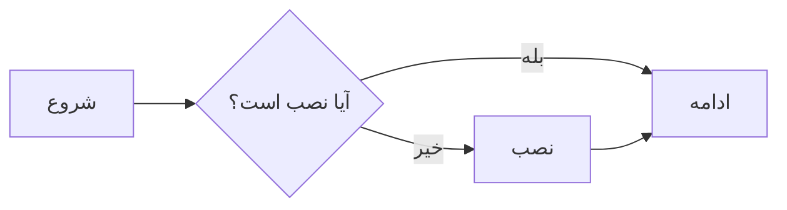

# 📝 آموزش جامع Markdown

> Markdown یک زبان نشانه‌گذاری ساده است که با آن می‌توانید متن را با چند کاراکتر ساده زیبا و ساختارمند کنید — بدون نیاز به HTML یا ابزار سنگین.

این آموزش مخصوص تمرین‌ها و گزارش‌های آزمایشگاه است؛ چون **همه‌ی فایل‌های این مخزن (README و گزارش‌ها) با Markdown نوشته می‌شوند** و ربات درستیار هم فایل‌های `.md` را مستقیم برای دانشجوها نمایش می‌دهد.

---

## ۱. چرا Markdown؟

| مزیت | توضیح |
|---|---|
| ساده و سریع | بدون نیاز به نرم‌افزار خاص؛ با هر ویرایشگر متنی کار می‌کند |
| خوانا در حالت خام | حتی بدون نمایش پیش‌نمایش، متن قابل خواندن است |
| استاندارد | GitHub، ربات درستیار، اکثر ابزارهای برنامه‌نویسی آن را می‌فهمند |
| سبک | یک فایل متنی ساده با پسوند `.md` |
| هم‌راه با گیت | diff و تاریخچه‌ی تغییرات به‌سادگی قابل مشاهده است |

---

## ۲. ساختار اصلی

### عنوان‌ها (Headings)
با `#` عنوان می‌سازید؛ هر چه `#` بیشتر، عنوان کوچک‌تر:

```markdown
# عنوان سطح ۱
## عنوان سطح ۲
### عنوان سطح ۳
#### عنوان سطح ۴
```

> قوانین ساده: فقط یک `#` (عنوان اصلی) در هر فایل داشته باشید؛ برای بخش‌ها از `##` و برای زیربخش‌ها از `###` استفاده کنید.

### پاراگراف و خط جدید
- می‌خواهید پاراگراف تازه بسازید: یک خط خالی بگذارید.
- برای رفتن به خط بعدی بدون پاراگراف جدید، دو فاصله در انتهای خط بگذارید یا از `\` استفاده کنید.

```markdown
این یک پاراگراف است.

این یک پاراگراف دیگر است.
```

---

## ۳. پرکاربردترین عناصر

### پررنگ و کج
```markdown
**این متن پررنگ است**
*این متن کج است*
***این متن پررنگ و کج است***
```

نتیجه: **این متن پررنگ است** · *این متن کج است* · ***این متن پررنگ و کج است***

### نقل‌قول (Quote)
```markdown
> این یک نقل‌قول است.
> می‌توانید چند خط هم بنویسید.
>> نقل‌قول تو در تو
```

### خط افقی
```markdown
---
```

---

## ۴. لیست‌ها

### لیست نامرتب
```markdown
- آیتم اول
- آیتم دوم
  - زیرآیتم (با دو فاصله یا Tab)
- آیتم سوم
```

نتیجه:
- آیتم اول
- آیتم دوم
  - زیرآیتم
- آیتم سوم

### لیست مرتب
```markdown
1. قدم اول
2. قدم دوم
3. قدم سوم
```

> در GitHub لازم نیست شماره‌ها دقیق باشند؛ فقط `1.` بنویسید تا خودکار شماره‌گذاری شود. اما برای خوانایی از شماره‌ی واقعی استفاده کنید.

### چک‌باکس (مخصوص GitHub)
```markdown
- [x] کار انجام‌شده
- [ ] کار باقی‌مانده
```

- [x] کار انجام‌شده
- [ ] کار باقی‌مانده

کاربرد عالی برای چک‌لیست تمرین‌ها و TODO.

---

## ۵. لینک و تصویر

### لینک
```markdown
[متن لینک](https://example.com)
[متن با عنوان](https://example.com "عنوان on hover")
```

مثال: [مخزن درس](https://github.com/manp/software-engineering-lab-course)

### مرجع لینک (برای تکرار لینک)
```markdown
[گیت][git]
[سایت گیت][git]

[git]: https://git-scm.com
```

### لینک به فایل‌های همین مخزن
از مسیر نسبی استفاده کنید:
```markdown
[جلسه ۱](../sessions/1-intro-git/index.md)
```

### تصویر
```markdown

```

> متن جایگزین (Alt) مهم است: وقتی تصویر نمایش داده نشود، همین متن دیده می‌شود و برای دسترس‌پذیری لازم است.

---

## ۶. جداول

```markdown
| ستون ۱ | ستون ۲ | ستون ۳ |
|---|---|---|
| مقدار | مقدار | مقدار |
| مقدار | مقدار | مقدار |
```

نتیجه:

| ستون ۱ | ستون ۲ | ستون ۳ |
|---|---|---|
| مقدار | مقدار | مقدار |
| مقدار | مقدار | مقدار |

### راست‌چین کردن ستون
```markdown
| راست | چپ | وسط |
|---:|---|---:|
| عدد | متن | عدد |
```

- `:---` یعنی چپ‌چین
- `---:` یعنی راست‌چین
- `:---:` یعنی وسط‌چین

> جدول‌ها برای گزارش نمره، لیست ابزارها، مقایسه‌ی گزینه‌ها در تمرین‌های آزمایشگاه عالی‌اند.

---

## ۷. کد و دستورها

### کد درون خطی
```markdown
برای نصب گیت دستور `sudo apt install git` را اجرا کنید.
```

### بلوک کد
با سه بک‌تیک (```)، و برای مشخص کردن زبان برنامه‌نویسی نام آن را بنویسید تا رنگ‌بندی شود:

````markdown
```python
print("سلام دنیا")
```
````

```python
print("سلام دنیا")
```

زبان‌های رایج: `bash`, `python`, `sql`, `html`, `javascript`, `json`, `yaml`

### بلوک کد بدون نام زبان
با چهار بک‌تیک برای نشان دادن خودِ علامت سه‌بک‌تیک داخل متن از این روش استفاده کنید:

````markdown
```
بدون برجسته‌سازی
```
````

---

## ۸. متن فارسی و RTL در GitHub

فایل‌های Markdown فارسی در GitHub به‌طور خودکار راست‌چین نمایش داده می‌شوند اما چند نکته: 

- برای اعداد فارسی و انگلیسی تعیین تکلیف کنید؛ در یک متن یکدست بنویسید (مثلاً همه عددها فارسی یا همه انگلیسی).
- داخل بلوک کد و جداول، متن فارسی و انگلیسی را از هم جدا کنید تا به‌هم نریزند.
- برای فاصله‌ی بین کلمه‌ی فارسی و کد/لینک انگلیسی یک فاصله بگذارید.

مثال درست:
> دستور `git status` را اجرا کنید و خروجی را در گزارش بنویسید.

مثال نادرست:
> دستور`git status`را اجرا کنید.

### HTML در Markdown (وقتی لازم شد)
برای وسط‌چین یا تنظیم خاص می‌توانید HTML هم بنویسید:

```html
<p align="center">متن وسط‌چین</p>
```

---

## ۹. نقشه و دیاگرام با Mermaid

GitHub و ربات درستیار (در صفحات) از **Mermaid** پشتیبانی می‌کنند؛ یعنی می‌توانید دیاگرام بکشید:

````markdown

````


انواع دیگر: `graph`, `sequenceDiagram`, `classDiagram`, `gantt`

---

## ۱۰. قالب پیشنهادی گزارش آزمایشگاه

یک الگوی ساده برای گزارش‌های تمرین‌تان:

```markdown
# گزارش تمرین ۱ — آزمایشگاه مهندسی نرم‌افزار

**نام:** علی رضایی  
**شماره دانشجویی:** ۴۰۰۱۲۳۴۵  
**تاریخ:** ۱۴۰۵/۰۷/۱۸

## هدف تمرین
توضیح کوتاه

## مراحل انجام
1. قدم اول
2. قدم دوم

## خروجی‌ها


## کد
```python
print("done")
```

## مشکلات و یادگیری‌ها
- مشکل: …
- راه‌حل: …

## جمع‌بندی
چند خط خلاصه
```

---

## ۱۱. تمرین کوتاه

1. یک فایل `report.md` بسازید و قالب بخش ۱۰ را کپی کنید.
2. نام و شماره‌ی خودتان را بنویسید.
3. یک جدول با ۳ ستون بسازید (ابزار، کاربرد، سختی).
4. یک تصویر از خروجی تمرین گیت اضافه کنید (مثلاً عکس از `git log --oneline`).
5. با گیت کامیت و پوش کنید — اتفاقاً همین کار، جلسه‌ی ۱ را هم تمرین می‌کند.

---

## 📚 منابع بیشتر

- [Markdown Guide (en)](https://www.markdownguide.org)
- [GitHub Markdown Documentation](https://docs.github.com/en/get-started/writing-on-github)
- مستندات ربات درستیار: فایل‌های `docs/course-repo-convention.md`
